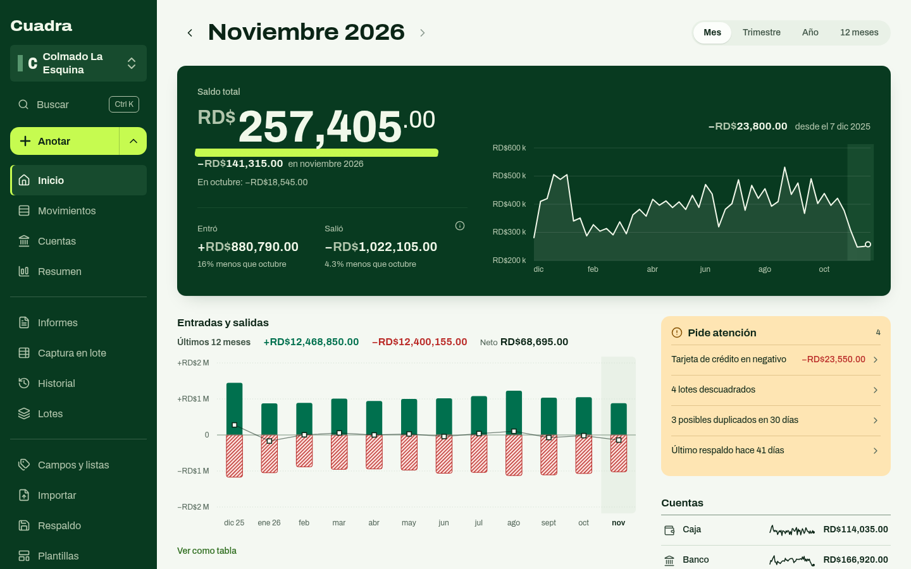
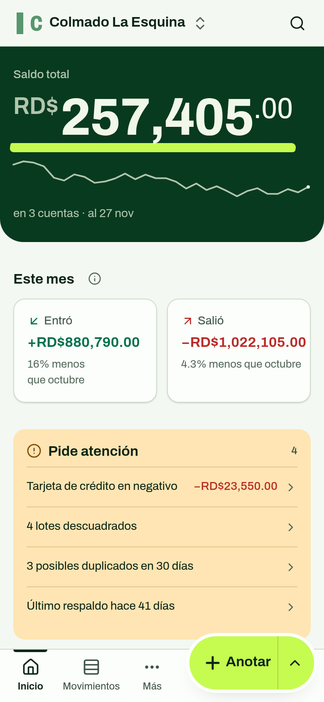
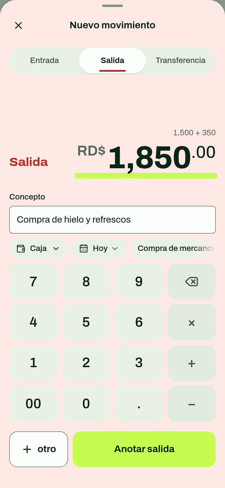
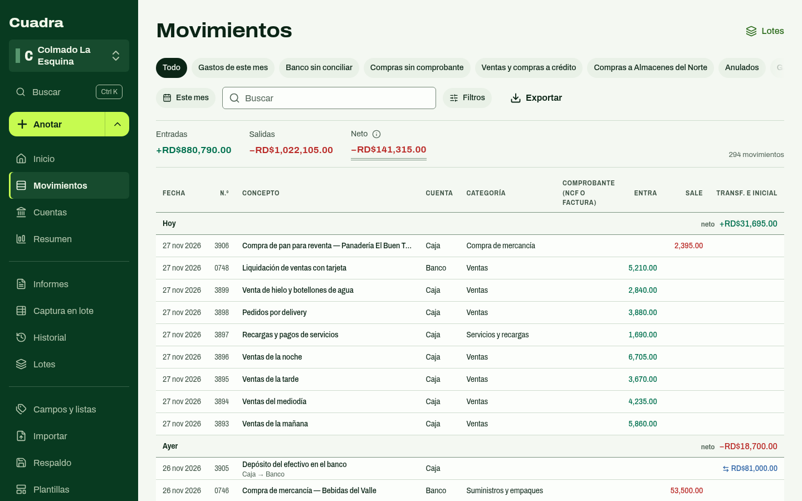
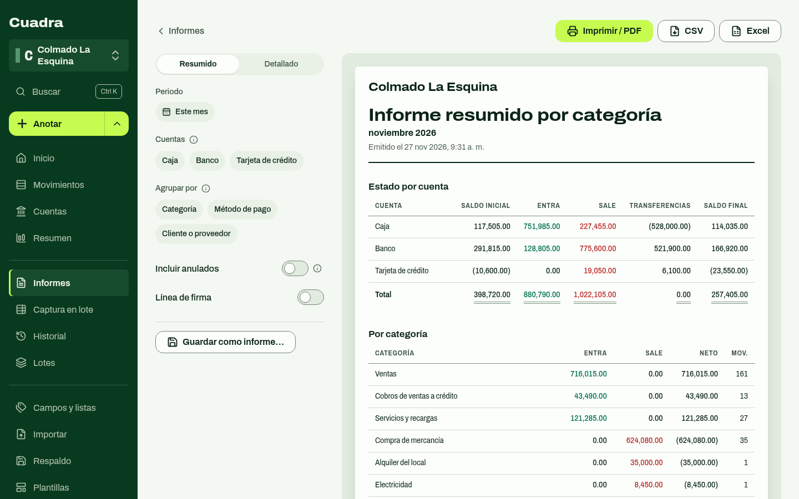

# Cuadra

Cuadra es una demo funcional de una libreta financiera (libro de caja, no partida doble) para negocios pequeños, contadores independientes y pymes. Registra entradas, salidas y transferencias entre cuentas, las filtra, las resume en gráficas e informes y deja rastro de cada cambio. No es un producto terminado: sirve para probar ideas.

**Demo en vivo: https://wilkerdev1.github.io/cuadra/**. Se puede instalar como app en Android y en escritorio desde el navegador. Los datos viven solo en el dispositivo; no hay servidor.

## Capturas

<p>
  
</p>
<p>
  
  &nbsp;
  
</p>
<p>
  
</p>
<p>
  
</p>

## Qué puedes probar en la demo

- **Datos de ejemplo.** Desde la bienvenida se cargan cuatro espacios ficticios con unos 14 meses de actividad, generados con semilla fija: un colmado, un cliente de despacho contable, unas finanzas personales y una iglesia (organización sin fines de lucro).
- **Anotar.** Entrada, salida y transferencia, con teclado numérico propio en móvil (admite sumas, restas y multiplicaciones) y sugerencias de concepto.
- **Captura en lote.** Tabla de captura con total de control, pegado desde Excel y lotes que se pueden anular o restaurar.
- **Plantillas.** Negocio pequeño, despacho contable, organización, finanzas personales y en blanco. Un espacio se guarda como plantilla y se exporta o importa como archivo.
- **Importar CSV y Excel.** Archivos `.csv`, `.txt`, `.tsv` y `.xlsx`, con asignación de columnas y vista previa. Hay plantilla modelo descargable.
- **Exportar CSV y XLSX.** Desde Movimientos y desde los informes.
- **Respaldo y restauración.** Respaldo completo a un archivo `.cuadra.json` y restauración desde ese archivo. Si el acceso tiene contraseña, el respaldo sale cifrado con ella; si no, sale en claro.
- **Acceso local.** Contraseña, pantalla de bloqueo, clave de recuperación, espera creciente tras intentos fallidos y bloqueo automático por inactividad configurable.
- **Historial.** Cada edición, anulación (con motivo) y restauración queda registrada, por movimiento y en general. Los movimientos no se borran, se anulan. Borrar un espacio entero sí elimina sus datos y su historial.
- **Informes.** Resumido y detallado, con vistas guardables, impresión a PDF, CSV y Excel.
- **Panel y resumen.** Panel de escritorio con gráficas que se adaptan al periodo (el mes día a día, el trimestre por semanas, el año y los 12 meses por mes; saldo con comparación del periodo anterior y lo programado a futuro) e interactivas (clic en una barra abre los movimientos que la forman), resumen por periodo y por cualquier campo, y avisos de lo que pide atención.

## Cómo correrlo

Se usa Node 26 (la versión del workflow de GitHub Pages; `package.json` no declara `engines`) y pnpm (el repositorio fija `pnpm@12.21.0` en `packageManager`).

```bash
pnpm install
pnpm dev         # servidor de desarrollo (Vite)
pnpm test        # Vitest
pnpm lint        # tsc -b
pnpm build       # compilación web/PWA en dist/
pnpm e2e         # Playwright (móvil 390x844 y escritorio 1440x900)
```

`pnpm e2e` compila la app y la sirve con `vite preview` en el puerto 4173. Usa el Chromium que tenga instalado Playwright.

Escritorio con Tauri 2:

```bash
pnpm tauri build --no-bundle
```

Genera el binario sin paquetes (en Linux, `src-tauri/target/release/cuadra`). Hace falta la cadena de Rust. El crate declara `rust-version = "1.77"`, pero las versiones fijadas en `Cargo.lock` piden más: `tauri` 2.12.7 declara 1.90 y `rusqlite` 0.43.0, 1.89. En la práctica hace falta Rust 1.90 o posterior. También hacen falta las dependencias de sistema de Tauri en Linux: WebKitGTK 4.1, `build-essential`, `curl`, `wget`, `file`, `libxdo-dev`, `libssl-dev`, `libayatana-appindicator3-dev` y `librsvg2-dev`. Esa lista no está en el repositorio: sale de la guía oficial de Tauri para Debian/Ubuntu, y en otras distribuciones los nombres cambian. Usa este comando y no un `cargo build --release` a secas: sin la función `custom-protocol` el binario intenta cargar `localhost:5173` en lugar de la app incrustada.

## Stack y arquitectura

TypeScript, React 19 y Vite, con SQLite compilado a WASM como base local. La lógica de dominio es TypeScript puro y habla con la base a través de un único puerto asíncrono (`SqlDriver`), de modo que el mismo SQL corre en el navegador, en Node (pruebas) y en Tauri. Tauri 2 es solo una cáscara fina de escritorio. Los montos son enteros en unidad menor, nunca flotantes. Detalle completo en [docs/ARCHITECTURE.md](docs/ARCHITECTURE.md).

Capas:

- `src/features/`: pantallas, una carpeta por área; se registran solas en el shell y no se importan entre sí.
- `src/app/`: shell, enrutado, y lectura/mutación con TanStack Query invalidada por eventos del núcleo.
- `src/ui/` e `src/i18n/`: sistema de diseño y cadenas en español.
- `src/core/`: dominio sin DOM ni React: dinero, cuentas, movimientos, campos, consultas, historial, plantillas, respaldo, importación, cifrado y datos de ejemplo.
- `src/data/`: migraciones SQL y adaptadores del puerto: worker WASM con OPFS (con candado entre pestañas), respaldo en memoria más IndexedDB si no hay OPFS, `node:sqlite` para pruebas y Tauri con `rusqlite`.
- `src-tauri/`: cáscara de escritorio en Rust: comandos `db_*` y diálogo «Guardar como».

## Decisiones de producto

Se partió de unos documentos de origen (inventario, especificación v2 y su análisis crítico). Lo que se tomó, lo que se cambió y lo que quedó fuera está en [docs/PLAN.md](docs/PLAN.md). Resumen:

**Se tomó** la idea central: libreta local con captura rápida, campos personalizables, historial de cambios, informes y respaldo, pensada para negocios pequeños y contadores.

**Se rediseñó**
- Un "libro" es una **cuenta** (dónde está el dinero). Fondo, centro de costo, categoría y contacto son campos de lista. Era el hueco más serio del modelo original.
- "Proyecto" pasó a llamarse **espacio**: un contador tiene uno por cliente.
- Lo específico de cada tipo de negocio vive en plantillas de datos, no en código.
- La importación desde Excel es CSV/XLSX con asignación de columnas y vista previa, sin IA.
- El acceso local protege lo que sale del equipo: la contraseña cifra los respaldos (AES-256-GCM con clave derivada por PBKDF2-SHA256).
- Stack: TypeScript, React y SQLite WASM para web/PWA, con Tauri 2 para escritorio, en lugar de Rust más escritorio solamente.

**Quedó fuera de la demo**
- Sincronización y servidor, y multiusuario: los datos son locales y no se decidió qué modelo de nube usar.
- Licencias y suscripción: no se construye la caja antes de saber qué se cobra.
- Asistente de IA: costo, privacidad (los datos no salen del equipo) y ningún usuario lo pidió.
- Respaldo a Drive: se cubre con archivo manual y copia local antes de operaciones destructivas.
- Conciliación bancaria, presupuestos, movimientos recurrentes, adjuntos y varias monedas. El modelo no los impide.
- App nativa para Android: la PWA instalable cubre Android.

## Límites conocidos

- **La base local no va cifrada.** La contraseña protege la entrada a la app y cifra los respaldos, pero quien tenga acceso al almacenamiento del dispositivo puede leer los datos.
- **El historial es honesto contra errores, no contra fraude.** Quien tenga el archivo puede alterarlo.
- **Tauri solo tiene prueba de humo en Linux (Wayland).** El binario arranca, carga la app incrustada y crea la base con las 12 tablas. No se recorrió la interfaz dentro de Tauri (no hay WebDriver de WebKitGTK), no se probó `save_file` con un clic real y no se probó Windows ni macOS.
- **No se probó la impresión real a PDF** (existe la vista imprimible con CSS `@media print`) **ni Safari/WebKit**. Las pruebas E2E corren en Chromium.
- **Una sola pestaña a la vez.** OPFS admite una sola conexión: la segunda pestaña muestra «Cuadra está abierta en otra pestaña» y ofrece tomar la base, con lo que la primera la cede. Sin OPFS, la base cae a memoria con volcado a IndexedDB.
- **El respaldo es un JSON de tablas**, no el archivo `.sqlite`. Las migraciones que cambien la forma de una tabla deberán traer su convertidor de respaldos (por ahora no hay ninguno registrado).
- **Los campos de tipo número se guardan como `REAL`**: sirven para cantidades, no para dinero.
- **Android nativo no existe** (faltan NDK y JDK 21 en el entorno de desarrollo); se usa la PWA.
- Estado de las pruebas al cierre de la Oleada 4 según la documentación: `pnpm test` con 980 pruebas y `pnpm e2e` con 33 en verde y 1 omitida (el panel en móvil).

## Licencia

El código de este repositorio se publica bajo la [licencia MIT](LICENSE). Las licencias de las dependencias de terceros están en [THIRD_PARTY_LICENSES.md](THIRD_PARTY_LICENSES.md).
